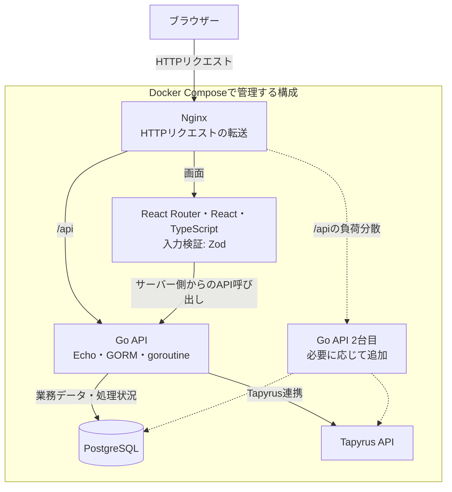
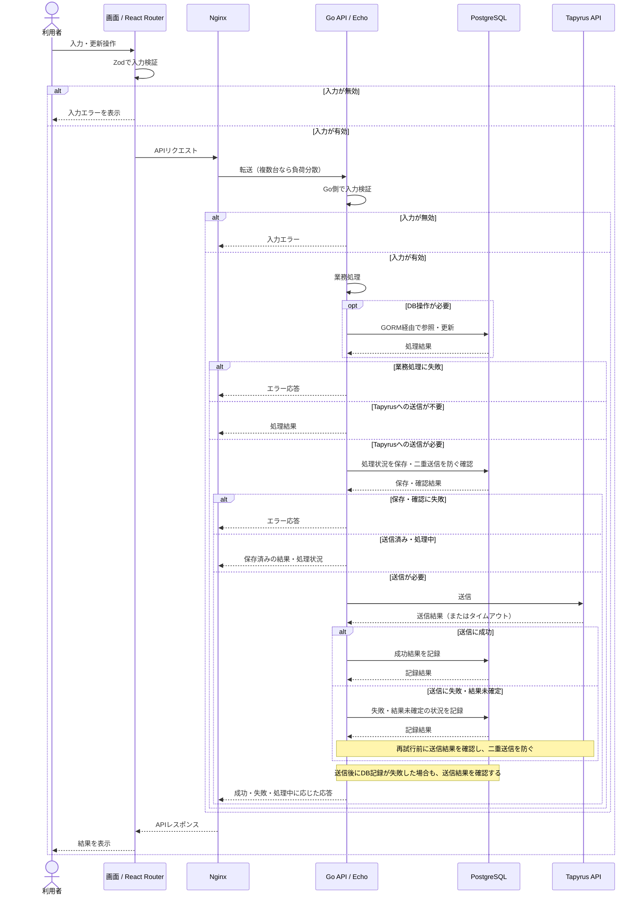

# mobile tracer

## システムを起動する

初回はリポジトリルートで次を実行します。Nginx、React RouterのSSRサーバー、Go API、PostgreSQL、Tapyrus Core・Esploraが起動します。

```bash
bash scripts/init.sh
docker compose up --build --wait --wait-timeout 180
python3 scripts/smoke.py
python3 scripts/nginx-smoke.py
```

画面は `http://localhost:8080/`、APIは `http://localhost:8080/api/health` など、同じオリジンで利用できます。Nginxが `/api` と `/api/` 配下をGo APIへ、それ以外をReact Routerへ転送します。パス・クエリ文字列・HTTPステータスは維持します。公開ポートはNginxの `127.0.0.1:8080` のみです。変更する場合は `.env` の `NGINX_PORT` を指定してください。

`/nginx-health` はNginx自身の稼働、`/api/health` はGo APIの稼働、`/api/ready` はDB・Tapyrusを含む準備状態を確認します。NginxはフロントとAPIのヘルスチェック成功後に起動します。

### 開発時に直接接続する

通常のCompose設定では、API・フロント・DBは内部ネットワークから接続します。ホストから直接接続する場合は開発用の設定を重ねます。

```bash
docker compose -f compose.yaml -f compose.debug.yaml up --build --wait --wait-timeout 180
```

| 接続先 | URL・ポート | 変更する変数 |
| --- | --- | --- |
| Nginx | `http://localhost:8080` | `NGINX_PORT` |
| Go APIへの直接接続 | `http://localhost:8081` | `BACKEND_DEBUG_PORT` |
| フロントへの直接接続 | `http://localhost:3000` | `FRONTEND_DEBUG_PORT` |
| PostgreSQL | `127.0.0.1:5432` | `DB_PORT` |

開発用の公開を解除するには、通常の `docker compose up -d --wait --wait-timeout 180` でサービスを更新します。停止・削除も、起動に使ったComposeファイルの組み合わせで実行してください。旧設定の `BACKEND_PORT` は使用しません。

NginxはHost（ポートを含む）、接続元IP、通信方式を転送します。クライアントが送った転送ヘッダーはNginxで上書きします。Go・SSRサーバーの `TRUSTED_PROXY_CIDRS` には、このローカルComposeで使うプライベートIPv4範囲を設定しています。Compose外で直接起動する場合の既定値は空で、転送ヘッダーを信頼しません。本番で使う場合は、実際のプロキシのアドレス範囲に合わせて指定します。

今回の構成はローカルHTTP用です。HTTPSと複数台への負荷分散は今後追加します。

Goを使ったローカル起動、環境変数、テストの実行方法は[バックエンドのREADME](backend/README.md)を参照してください。

Tapyrusの初期化、接続確認、検証用送金、停止・データ削除の方法は[Tapyrusのローカル開発環境](docs/tapyrus.md)に記載しています。外部テストネットに接続せず、単一ノードの開発モードで検証します。

## 要件定義書とPDF

要件の原本は[docs/design.md](docs/design.md)、最新版PDFは[docs/design.pdf](docs/design.pdf)です。編集・環境準備・改訂版保存・共有ドライブへの手動アップロードの手順は[docs/README.md](docs/README.md)を参照してください。

準備後は、リポジトリルートで `bash scripts/docs/docs.sh build` を実行すると、文書チェックと最新版・改訂版PDFの生成を行えます。

要件・受入条件・目標の対応検査結果は[docs/quality/traceability.json](docs/quality/traceability.json)、使用したスキルと適用範囲は[docs/skill-sources.md](docs/skill-sources.md)に記録しています。

レビュー用の説明資料は[Marp原稿](docs/03_marp_mobiltracer-review.md)と[18枚のPDF](docs/03_marp_mobiltracer-review.pdf)です。`npm --prefix scripts/slides run build` で生成します。初回準備と改訂版保存は[文書の運用手順](docs/README.md)を参照してください。

## 構成と設計方針

React Router、Go、PostgreSQL、Tapyrus APIをそれぞれDockerコンテナで動かし、NginxでHTTPリクエストの振り分けをまとめて管理する構成を採用します。開発環境ではDocker Composeで各サービスを起動する方針です。

現在はNginx経由の画面・APIへのアクセス、フロントエンドの開発環境・CI、Go・Echoによる車両・案件・記録・下書きの基本操作API、PostgreSQLのスキーマ・API接続と、Tapyrus Core・Esploraのローカル開発環境を用意しています。APIの入出力と開発用データの導入手順は[フロントエンド向けAPI仕様](docs/api.md)を参照してください。以下には、今後導入する技術を含めた設計方針を記載します。

### 技術構成図

各ノードを独立したコンテナとして管理します。Go APIの2台目は、負荷テスト後に必要に応じて追加する構成です。点線は追加予定の接続を表します。



ESLint・Vitest・Playwrightは開発・テスト時に使用し、常駐するサービスのコンテナとは分けて扱います。React Routerのサーバー側からGo APIへの接続も、Go APIの複数台構成を導入する際に振り分け方法を検討します。

Nginxで外部からのHTTPリクエストを受け付け、画面のリクエストはReact Routerへ、APIのリクエストはGoへ転送する想定です。React Routerのサーバー側からAPIを呼ぶ場合は、内部ネットワークでGoへ接続します。PostgreSQLとTapyrus APIへの接続はGoに集約します。NginxはHTTP通信を管理し、コンテナの起動・停止や接続設定はComposeで管理します。

最初は、業務処理をひとつのGoアプリケーションにまとめる簡素な構成にします。コードはHTTPの受付、業務処理、DB・Tapyrus APIへの接続という責務で分け、機能ごとのサービス分割や独自のロードバランサーは導入しない方針です。

### 技術の役割と選定理由

| 技術 | 役割・選定理由 |
| --- | --- |
| React Router・React・TypeScript | 画面、ルーティング、画面に必要なデータ取得をまとめます。既存のフロントエンドを活用し、画面側の構成を揃えます。 |
| ESLint | コードを静的に検査します。問題のある書き方を、テストやレビューの前に検出するために採用します。 |
| Vitest | 関数や画面の部品など、小さな単位のテストを担当します。既存のViteを使った開発環境と設定を合わせやすいため採用します。 |
| Zod | フォーム入力やAPIレスポンスなど、実行時に受け取るデータを検証します。TypeScriptの型だけでは確認できない入力を扱うために採用します。 |
| Playwright | ブラウザーで画面を操作し、主要な利用手順をE2Eテストで確認します。画面とAPIをつないだ動作を検証するために採用します。 |
| Go・Echo | Goで業務APIを実装し、Echoでルーティングや共通のHTTP処理をまとめます。APIの基本処理を簡潔に記述するために採用します。 |
| GORM | GoからPostgreSQLを操作します。定型的なDBアクセスをまとめ、業務処理を読みやすく保つために採用します。 |
| goroutine | Go内で処理を並行して実行する言語機能です。独立した処理を並行させる場合に利用し、同時実行数は制御します。 |
| PostgreSQL | 業務データと処理状況を保存します。トランザクションや制約を使ってデータの整合性を管理するために採用します。 |
| Tapyrus API | ローカル開発ではTapyrus CoreのRPCとEsploraのREST APIへGoから接続します。ハッシュ登録の業務処理と本番での接続・運用方式は別Issueで実装・決定します。 |
| Docker・Docker Compose | サービスごとに実行環境を分け、開発・結合テストで同じ構成を起動できるようにします。 |
| Nginx | HTTPの転送と、複数のアプリケーションコンテナへの負荷分散を担当します。通信の設定を一か所にまとめるために採用します。 |

各ツールの機能は、[React Router](https://reactrouter.com/start/framework/rendering)、[ESLint](https://eslint.org/docs/latest/use/core-concepts/)、[Vitest](https://vitest.dev/guide/)、[Zod](https://zod.dev/)、[Playwright](https://playwright.dev/docs/test-assertions)、[Echo](https://echo.labstack.com/docs/routing)、[GORM](https://gorm.io/docs/connecting_to_the_database.html)、[Go](https://go.dev/doc/effective_go#goroutines)、[PostgreSQL](https://www.postgresql.org/about/)の公式資料を参照してください。

### 想定する実装の分担

React Routerは画面と画面に必要なデータ取得を担当し、業務上の判断やDB更新はGoにまとめます。フロントエンドではZodで入力を検証し、Goでも受け取った値を検証します。

GoはEchoでリクエストを受け付け、業務処理からGORMとTapyrus APIのクライアントを呼び出す構成を想定しています。最初から多くの抽象化や階層を設けず、処理の重複やテストの必要性に応じて分けます。

DB更新とTapyrusへの送信は、ひとつのDBトランザクションだけでは完了を保証できません。処理状況をPostgreSQLに保存し、再試行時の二重送信を防ぐ方法や、送信結果を確認する手順を設計します。完了保証が必要な処理は、goroutineのメモリ上の状態だけに依存させない方針です。

### シーケンス図

利用者が画面から更新操作を行う場合の想定です。各コンポーネント間の呼び出しと応答を、上から順に示します。処理状況の保存方法や送信結果を確認するタイミングは、実装時に具体化します。



図はブラウザーからNginxを経由してAPIを呼ぶ場合を示しています。React Routerのサーバー側から呼ぶ場合は、内部ネットワークでGo APIに接続します。

### 負荷分散と並行処理

まずはGo APIを単一コンテナで動かし、負荷テストで必要性を確認してから複数に増やします。複数に増やした際は、NginxのupstreamでGo APIへリクエストを振り分けます。初期案は順番に振り分けるラウンドロビンとし、接続が長く続く場合は接続数の少ないサーバーへ振り分ける方式も検討します。方式の詳細は[Nginxの公式資料](https://nginx.org/en/docs/http/load_balancing.html)を参照してください。

Go側は各コンテナ内の並行処理を担います。goroutine自体は、複数コンテナへリクエストを振り分ける機能ではありません。必要な並行処理には同時実行数の上限、タイムアウト、キャンセルを設け、DBやTapyrus APIへ処理を送りすぎないようにします。

Go APIは、セッションや処理状況を特定のコンテナのメモリだけに保存しない設計にします。コンテナを増やす際は、全コンテナのDB接続数の合計とTapyrus APIへの同時接続数も確認します。GORMの接続プールはGoの`database/sql`を利用するため、その上限を調整します。[GORMの接続プール設定](https://gorm.io/docs/connecting_to_the_database.html#Connection-Pool)

初期構成ではNginxとPostgreSQLをそれぞれ単一で動かす想定です。Go APIの台数を増やしても、構成全体の冗長化やDB・Tapyrus APIの性能改善までできるわけではありません。React Routerの複数台構成も、画面側の負荷を測定したうえで検討します。

### 負荷テストで確認すること

負荷テストはNginx経由で行い、画面表示、APIの参照・更新、Tapyrusへの送信を含む操作を分けて測定します。ツールは未選定です。Playwrightは操作が正しく完了するかの確認に使い、継続的な負荷をかけるテストは別途用意します。

| 観点 | 確認する内容 |
| --- | --- |
| 応答と処理量 | 同時アクセスを増やしたときの応答時間、p95・p99、毎秒の処理数、エラー率。p95・p99は、それぞれ95%・99%のリクエストが収まる応答時間です。 |
| アプリケーション | CPU・メモリ使用量、goroutine数、タイムアウト、Nginxからの振り分け状況。 |
| DB・外部接続 | DB接続の待ち時間、クエリやロックの待ち時間、Tapyrus APIの応答時間と失敗率。 |
| 台数を増やした効果 | 同じ条件でGo APIが単一の場合と複数の場合を比較し、改善幅と新たに処理の待ち時間が増える箇所を確認します。 |
| 障害と再試行 | Go APIの停止やTapyrus APIの遅延時に、エラー処理、復旧、二重送信の防止が想定どおり動くかを確認します。 |

目標の同時アクセス数と応答時間は、想定する使い方が固まってから決めます。環境、データ量、コンテナ数、負荷の条件を記録して比較できるようにします。Tapyrus APIを模擬したテストと、専用の検証環境で実際に連携するテストを分け、結果にどちらの条件かを記載します。

## 開発の進め方

### Issueには概要と対応内容を書く

作業はIssueで管理します。タイトルは変更の目的が分かる短い文にし、本文には最低限「概要」と「対応内容」を書きます。不具合の場合は、再現手順、期待する動作、実際の動作も分かる範囲で追記します。

以下はIssueの記入例です。

```markdown
タイトル: フロントエンドにESLintを導入する

## 概要
コードの問題を開発中とCIで検出できるようにする。

## 対応内容
- ESLintの設定を追加する
- npm run lintで検査できるようにする
- CIでlintを実行する
```

### ブランチの命名規則

作業ブランチは、変更の種類、Issue番号、作業内容を組み合わせて命名します。作業内容は小文字の英語をハイフンでつなぎます。

```text
<種類>/<Issue番号>-<作業内容>
```

| 種類 | 用途 | 命名例（番号は例示） |
| --- | --- | --- |
| `feat` | 機能の追加 | `feat/10-add-api` |
| `fix` | 不具合の修正 | `fix/11-fix-validation` |
| `docs` | ドキュメントの更新 | `docs/12-update-readme` |
| `chore` | 環境構築や依存関係、CIの整備 | `chore/13-add-eslint` |
| `refactor` | 振る舞いを変えないコードの整理 | `refactor/14-extract-service` |
| `test` | テストの追加や修正 | `test/15-add-e2e-tests` |

コミットメッセージにも変更の種類とIssue番号を含めます。担当者の指定はIssueやPRで管理します。

```text
chore: ESLintの設定を追加 #13
```

### Gitフロー

`main`をリリース用、`develop`を開発内容の統合用とし、個々の作業はIssueに対応するブランチで進めます。

1. Issueを作成し、作業の目的と対応内容を整理します。
2. 最新の`develop`から作業ブランチを作成します。
3. 変更をコミットしてpushし、`develop`に向けたPRを作成します。
4. CIとレビューで変更を確認し、`develop`へマージします。
5. リリースする変更が揃ったら、`develop`から`main`へのPRを作成します。
6. 変更内容と確認結果をレビューし、`main`へマージします。

作業ブランチ → `develop` → `main`の順に変更を取り込みます。この流れを基本とし、リリース専用ブランチなどは必要になった段階で検討します。

### PRには変更と確認結果を書く

PRのタイトルは、何を変更するかが分かる短い文にします。本文には「概要」または「対応内容」を記載し、関連するIssue番号も添えます。両方の見出しを埋める必要はありません。

コマンドを実行した結果や動作確認の結果があれば、実行内容と結果を書きます。未実施の場合は、その旨を書き、確認済みの内容と区別します。結果は実際に確認した範囲だけを記載します。

以下は、コマンドの実行が成功し、ブラウザーでの確認は未実施の場合のPRの記入例です。

```markdown
タイトル: chore: ESLintを導入する

## 対応内容
- ESLintの設定とlintスクリプトを追加
- CIにlintを追加

## 実行・動作確認の結果
- npm run lint: 成功
- npm run typecheck: 成功
- npm run build: 成功
- ブラウザーでの動作確認: 未実施

## 関連Issue
#13
```

## CIの構成

設定は[`.github/workflows/ci.yml`](.github/workflows/ci.yml)で管理しています。`main`・`develop`へのpushと、この2つをマージ先とするPRで起動します。

| ジョブ | 実行内容 | 実行条件 |
| --- | --- | --- |
| `quality` | `npm ci`、ESLint、型チェック、Vitest、本番ビルド | 毎回実行 |
| `detect` | Go API・結合テストに必要な実装の有無を確認 | 毎回実行 |
| `e2e` | Chromiumを準備し、本番ビルドに対してPlaywrightを実行 | 毎回実行 |
| `backend` | Goの整形確認、静的解析、データ競合を検出するテスト、APIのビルド | GoモジュールとAPIのエントリーポイントがある場合 |
| `integration` | 全サービスの起動、Nginx経由の画面・API・ブラウザー操作、DB障害復旧・制約、Tapyrus送金・承認・データ保持、初期化の再実行を確認 | 必要なファイルが揃い、backendが成功した場合 |

`quality`・`e2e`・`detect`は並列で動きます。`backend`は`detect`の判定後に実行されます。

`integration`は`backend`の成功後に、フロントエンドの検証と独立して実行します。必要なファイルの存在も確認し、ワークフローがキャンセルされた場合は実行しません。

Playwrightのレポートと、失敗時のスクリーンショット・トレースは、`e2e`ジョブの成果物`playwright-results`と、`integration`ジョブの`nginx-playwright-results`として7日間保存します。ローカルでの実行手順は[フロントエンドのREADME](frontend/README.md#testing)を参照してください。

Node.jsを使うジョブでは、24.22.1以上・25未満の範囲で最新のバージョンを取得します。依存パッケージは`frontend/package-lock.json`に従ってインストールします。

結合テストを有効にするには、Go APIに加え、次のファイルが必要です。

```text
compose.yaml
docker/nginx/default.conf
frontend/Dockerfile
frontend/server.js
backend/Dockerfile
backend/cmd/tapyrus-check/main.go
docker/tapyrus/init.sh
docker/tapyrus/bootstrap.sh
scripts/init.sh
scripts/smoke.py
scripts/nginx-smoke.py
scripts/db-smoke.py
scripts/tapyrus-smoke.py
```

結合テストが失敗した場合はComposeのログを出力します。終了時には、成功・失敗にかかわらずサービスを停止し、ボリュームを削除する処理を実行します。


### 今後追加する検証

業務APIの追加に合わせて、Nginx経由の結合テストを増やします。負荷テストは、環境と負荷条件を揃えて実行できる手動・定期実行用のジョブを検討します。
