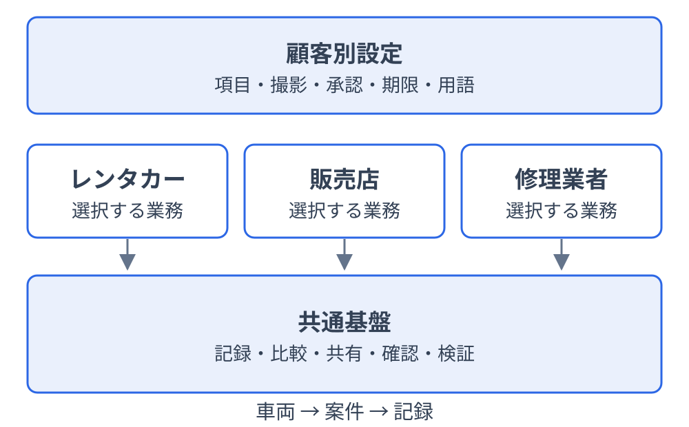
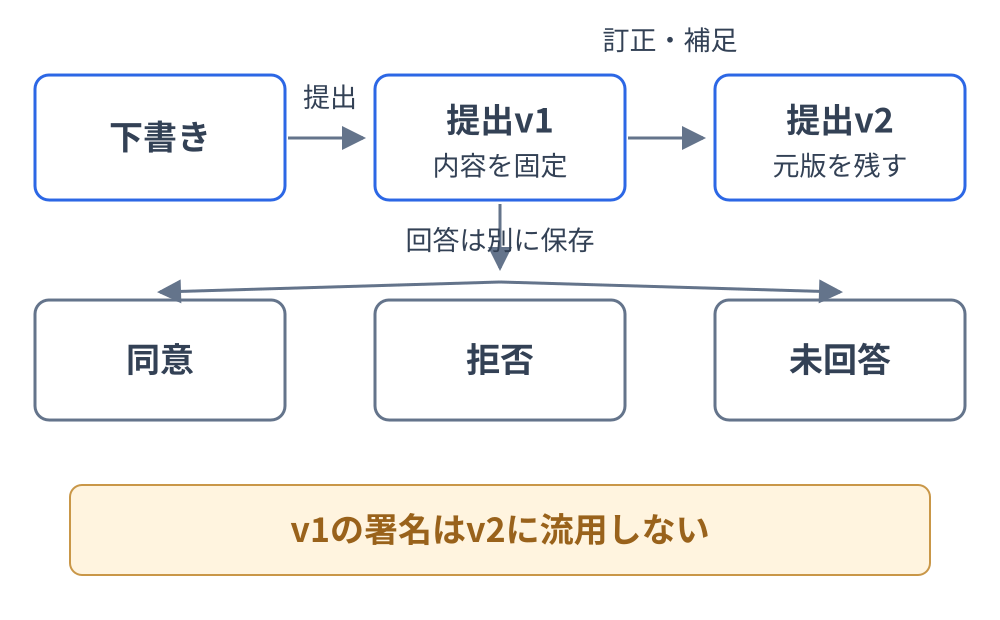
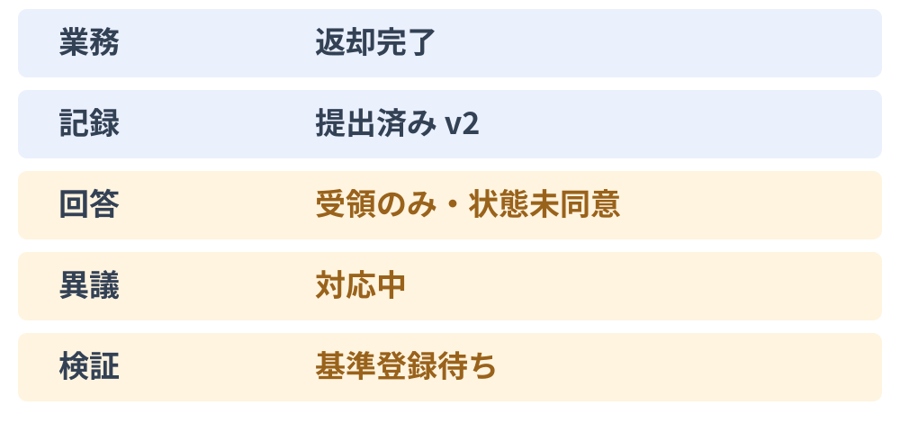
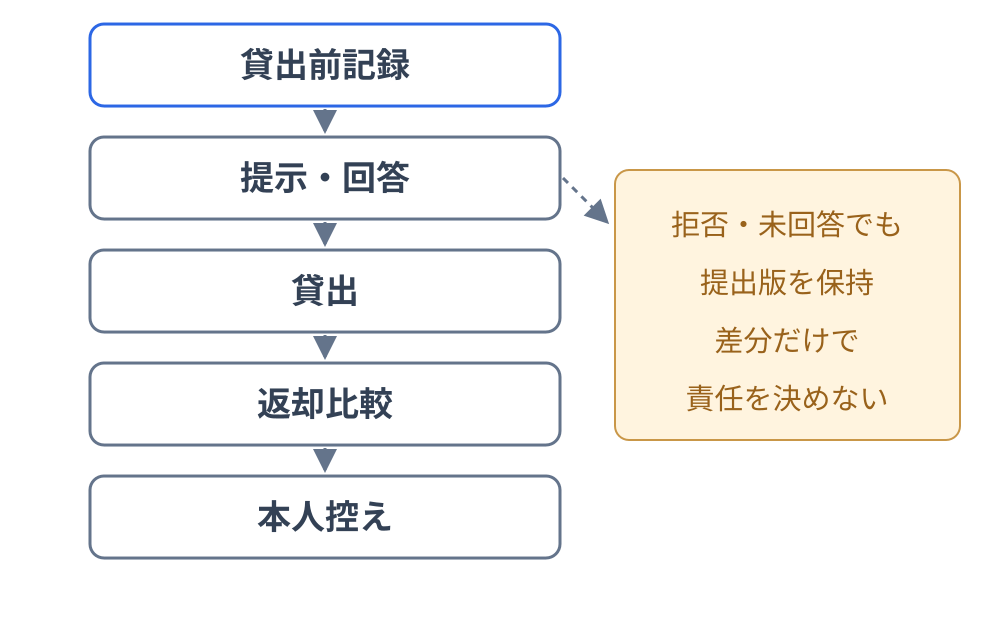
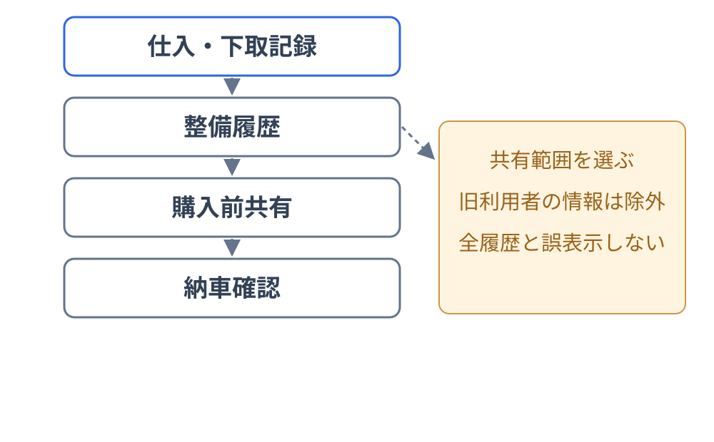
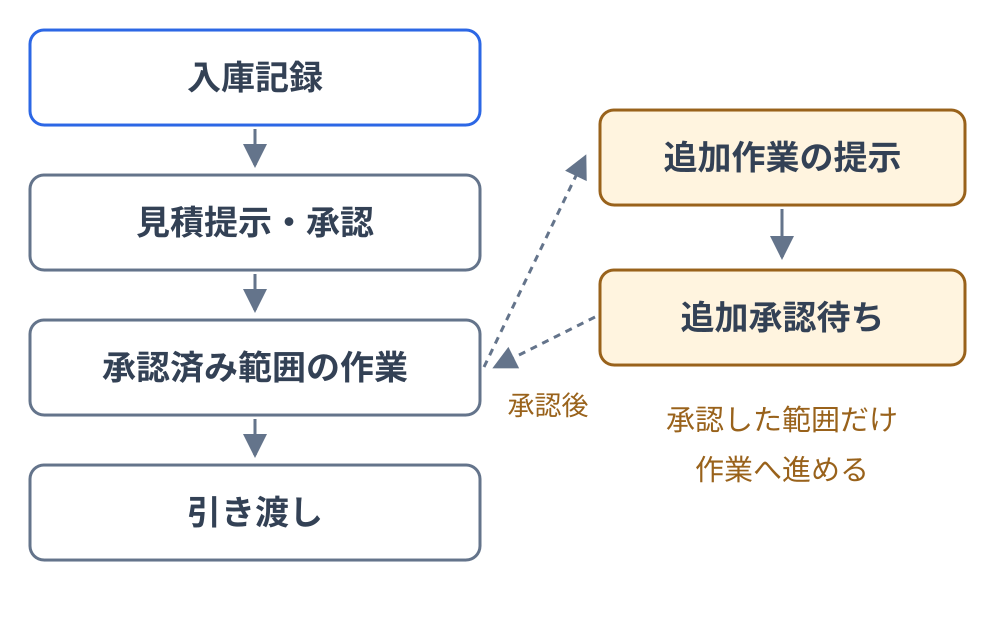
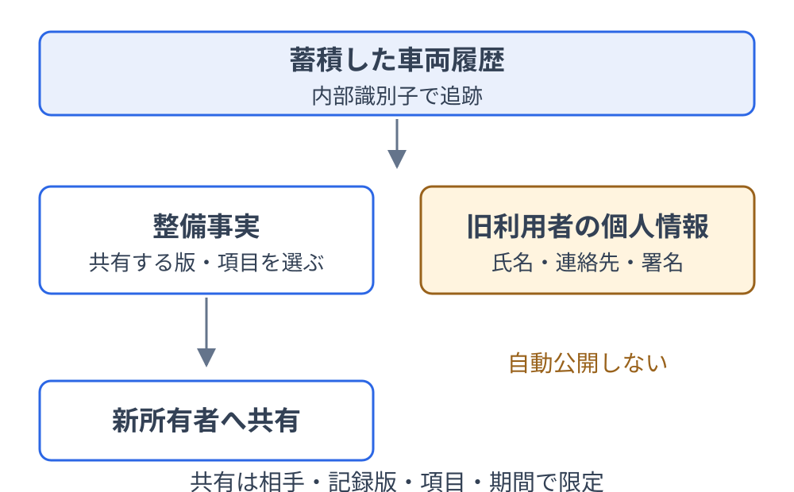

<!-- _class: title -->
<!-- _paginate: false -->

# MobilTracer 要件レビュー

車両の記録・共有・確認・検証

三業態で共通基盤を使うための要件をレビューする

要件定義書 v0.2.0 ／ 説明資料 v0.1.0

検討案・顧客承認前

<!-- 発表メモ: 完成した製品の紹介ではなく、対象範囲と受入を確認する資料。説明15分を目安とし、質疑・合意形成は別に行う。 -->

---

<!-- _footer: 参照：要件定義書 第2・3章 ／ 発表資料 p.2・4 -->

# 同じ記録を後から確かめる

車両の状態を、関係者が確認できる記録へ変える。

- 預ける前後の状態を残す
- 同じ内容を相手へ提示する
- 提示内容と回答を後から確認する

顧客：導入する事業者

利用者：借受人・購入者・修理依頼者

提供側：MobilTracerを構築・保守する主体

<!-- 発表メモ: レンタカーの傷を例に説明し、販売・修理にも共通する課題へつなぐ。相談件数や請求額は再検証していないため掲載しない。 -->

---

<!-- _class: content-image-right content-35 -->
<!-- _footer: 参照：第5・9章 ／ FR-T01・FR-T02・CON-003 -->

# 三層で顧客に合わせる

共通基盤を保ち、業務と顧客設定を組み合わせて提供する。

### 共通基盤
記録・共有・確認・検証

### 業務モジュール
貸出・販売・修理

### 顧客別設定
項目・撮影・承認・期限

<!-- 発表メモ: 共通する情報の関係は車両→案件→記録。顧客ごとにコードを複製する方式を基本にせず、共通基盤を継続更新する。 -->

---

<!-- _class: column-layout -->
<!-- _footer: 参照：第5章 ／ FR-C05・FR-C13・FR-T02・FR-T03 -->

# 設定と追加開発の境界

顧客要望を、標準・設定・追加モジュール・個別開発に分けて判断する。

## 標準
提出版・権限・監査

## 設定
撮影箇所・必須項目・承認順

## 追加モジュール
再利用できる業務能力

## 個別開発
設定等で表せない顧客固有要件

8方向撮影・24時間の異議受付は、初期設定の候補。

<!-- 発表メモ: 個別開発の判断には更新追随・保守費用・情報保護を含める。権限分離、提出版の保全、未合意の表示は設定で解除できない。 -->

---

<!-- _class: section -->
<!-- _paginate: false -->
<!-- _footer: "" -->

## 記録・合意・検証を分ける

何が残り、何に同意し、何を確かめられるか

<!-- 発表メモ: 記録が存在すること、相手が同意したこと、検証できることは別々に扱う。ここから三業態に共通する記録の扱いを説明する。 -->

---

<!-- _class: content-image-right content-40 -->
<!-- _footer: 参照：FR-C07・FR-C08・FR-C11 ／ AC-03・AC-09 -->

# 署名がなくても記録を残す

相手の回答に関係なく、提出時点の内容を固定して保存する。

- 提出版は変更不可
- 無回答・拒否でも提出版を保持
- 訂正は元版を残して追記

<!-- 発表メモ: v1への署名をv2へ流用しない。発表資料p.8・11・13の「双方署名が揃った時だけ記録追加」という方針を、今回の指定に合わせて変更している。 -->

---

<!-- _class: column-layout -->
<!-- _footer: 参照：FR-C08・FR-M03 ／ AC-02・AC-09 -->

# 確認の意味を分ける

閲覧・受領・状態同意・作業承認を混同しない。

## 閲覧
内容を表示した

## 受領
記録を受け取った

## 状態同意
提示された状態へ同意した

## 作業承認
対象作業の実施を認めた

回答は、記録版・確認文面・回答者に結びつける。

<!-- 発表メモ: 開封だけでは明示的な受領回答にならない。受領だけを状態同意にせず、無回答や期限経過を承認に変えない。作業承認は対象範囲と金額に結びつく。 -->

---

<!-- _class: content-image -->
<!-- _footer: 参照：第9章 ／ FR-C10・FR-C13・AC-08 -->

# 完了を一つの状態にしない

業務・記録・回答・異議・検証の状態を併記する。

業務完了は、双方同意や登録完了を意味しない。

<!-- 発表メモ: 概念上の表示例であり、実装済み画面のスクリーンショットではない。登録状態と照合結果も別に管理する。 -->

---

<!-- _class: column-layout comparison -->
<!-- _footer: 参照：FR-C09・FR-C10・NFR-03・NFR-12・AC-04 ／ 発表資料 p.13 -->

# 検証できる範囲を示す

登録後の変更の検出と、撮影内容や責任の証明を区別する。

## 照合の対象

原本と独立基準の比較

差し替えの検出

基準・原本不足時の検証不能

## 別途の確認が必要

撮影内容の真実性

傷の責任

請求の妥当性・法的効力

Tapyrusは技術候補。登録状態と照合結果も分ける。

<!-- 発表メモ: 通常DBの照合値まで変えた場合も、独立基準との不一致を確かめる。写真そのものや直接識別できる個人情報はチェーンへ載せない。 -->

---

<!-- _class: section -->
<!-- _paginate: false -->
<!-- _footer: "" -->

## 三業態で共通基盤を確かめる

貸出・納車・修理の代表フローで確認する

<!-- 発表メモ: 業務は違っても記録・提示・回答・比較を共通化する。次の3枚では各業態の正常な流れと、代表的な例外を扱う。 -->

---

<!-- _class: content-image-right content-40 -->
<!-- _footer: 参照：FR-M01・FR-C06・FR-C13 ／ AC-01・AC-03・AC-15 -->

# 貸出前後の状態を比べる

同じ箇所で記録・比較し、確認と異議を残す。

- 状態・燃料・距離・備品を記録
- 借受人へ提示して回答
- 返却時に比較し、異議も保全

<!-- 発表メモ: 差分だけで責任や請求を決めない。署名拒否・未回答でも提出版を保持し、貸出続行の条件は顧客設定・業務判断として確認する。 -->

---

<!-- _class: content-image-right content-40 -->
<!-- _footer: 参照：FR-M02・FR-C18 ／ AC-01・AC-06 -->

# 選んだ履歴を購入者へ共有

仕入・整備・納車の履歴から、必要な範囲を購入者へ提示する。

- 仕入・下取時の状態を記録
- 整備履歴から共有範囲を選択
- 納車版への受領・同意を確認

<!-- 発表メモ: 過去利用者の個人情報を除外する。共有された履歴だけを車両の全履歴と表示せず、出所不明の履歴も確認済みにしない。 -->

---

<!-- _class: content-image-right content-40 -->
<!-- _footer: 参照：FR-M03・FR-C08 ／ AC-01・AC-09 -->

# 承認した作業範囲を残す

当初見積と追加作業の承認を、別の対象として残す。

- 入庫時の状態と依頼を記録
- 見積の内容・金額を承認
- 追加作業は別途承認

<!-- 発表メモ: 追加承認前の範囲は着手可能な段階へ進めない。内容や金額の変更後は再提示し、内部承認を利用者の作業承認に置き換えない。 -->

---

<!-- _class: content-image-right content-40 -->
<!-- _footer: 参照：FR-C02・FR-C12・FR-C17・FR-C18 ／ AC-06・AC-13 -->

# 履歴と公開範囲を分ける

履歴を引き継ぐことと、過去の個人情報の公開を分ける。

- 内部識別子で車両を追跡
- 所有者変更で自動公開しない
- 相手・版・項目・期間で限定

<!-- 発表メモ: ナンバーだけに識別を依存させない。取消しは以後の取得へ反映するが、取得済み帳票の回収や無期限の本人控え閲覧を約束しない。 -->

---

<!-- _footer: 参照：第11・12章 ／ GOAL-001〜GOAL-004・AC-01〜AC-05 -->

# MVPで確かめる五つの条件

記録・共有・確認・検証の中核価値を実証する。

1. 三業態を共通基盤と設定で実行
2. 提示内容と回答を後から閲覧
3. 署名拒否・異議でも提出版を保持
4. 写真差し替えを検出
5. 設定変更から他社・確定版を保護

<!-- 発表メモ: 製品試験は未実施。架空データの実証だけで本番導入可能と判断せず、本人確認・保存・復旧・サポート等の導入条件も確認する。対応表の100%は製品試験の合格率ではない。 -->

---

<!-- _class: column-layout -->
<!-- _footer: 参照：第4・11章 ／ FR-T07・FR-A01・CON-001・CON-002 -->

# 拡張機能は段階を分ける

中核実証の範囲と、導入後に選ぶ拡張を区別する。

## 導入後に検討

動画・大量移行、
高度な承認・通知、外部連携は、
導入検証後に選ぶ。

## 将来の確認支援

AIは、傷・変化の候補、
撮影品質、入力の確認を
支援する候補。

AIなしで基本業務を実行。責任・請求の自動決定は対象外。

<!-- 発表メモ: 予約・決済・会計・在庫・部品発注を自動的にMVPへ含めない。車両以外への適用も将来構想である。 -->

---

<!-- _footer: 参照：第10・13章 ／ OQ-001・OQ-002・OQ-003・OQ-006・OQ-007・OQ-010 -->

# 導入前に決める四つの条件

本人確認、検証方式、保存・共有、非機能条件を合意して進む。

| 論点 | 決める内容 |
| --- | --- |
| 本人確認・署名 | 回答者の確認方法、承認の意味 |
| 検証基盤 | 方式・運用主体・障害時対応 |
| 保存・共有 | 保存期間・削除・本人控え |
| 性能・復旧 | 規模・回線・復旧目標・サポート |

数値は提案。予算・体制・日程も実装計画の前に確認する。

<!-- 発表メモ: 候補責任者は未任命であり、数値は実測・顧客合意前。四つの論点で未決台帳10件を置き換えない。 -->

---

<!-- _class: all-text-center align-center closing -->
<!-- _footer: 詳細：要件定義書 v0.2.0 ／ 第1・12・13章 -->

# レビューで合意すること

業務の適合、MVPの範囲、未決事項の決め方を確認する。

代表フローに不足はないか

MVPの五条件で何を確かめるか

未決事項を誰が・いつ決めるか

<!-- 発表メモ: 結果は対象の要件ID・記録版とともに残す。仕様変更は原本の版と履歴を更新する。資料を読んだことを承認と解釈しない。 -->
