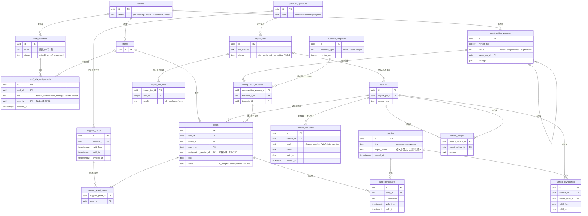
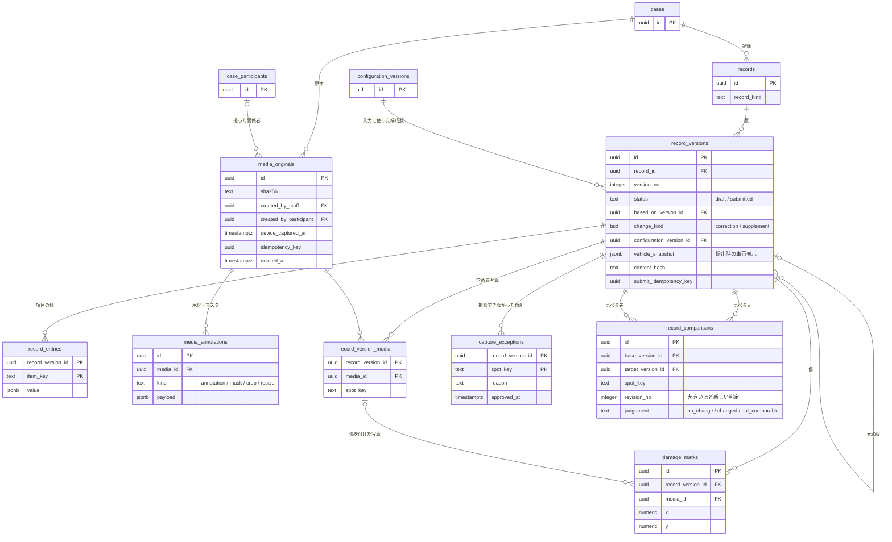
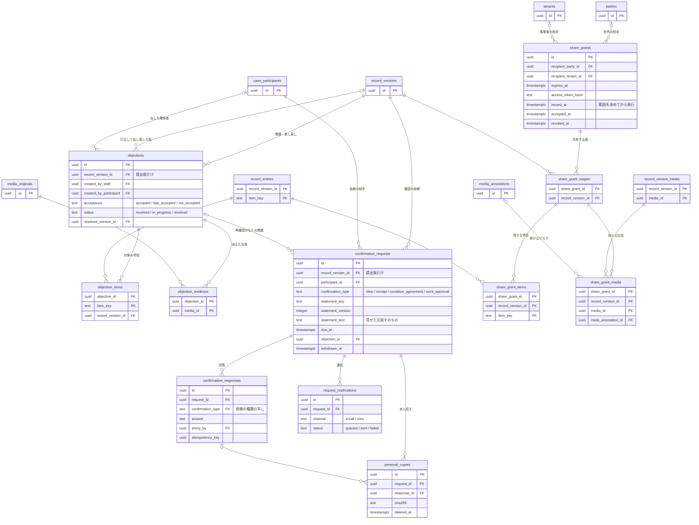
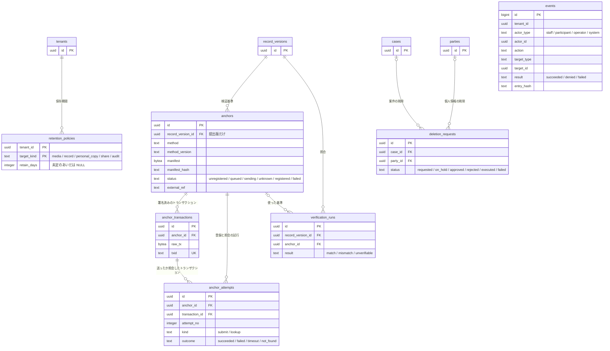

# ER 図（たたき台）

[tables.md](tables.md) のテーブル案を、四つの範囲に分けて描いています。列は主キー、外部キー、状態など関係を読むのに必要なものだけを載せています。全列は [000001_init.up.sql](../../backend/db/migrations/000001_init.up.sql) を見てください。

- ほぼすべてのテーブルが `tenant_id` を持ち、複合外部キーで同じ顧客の行だけを指します。図では `tenant_id` と `tenants` への線を省いています。
- 案件の下の表は `case_id` も持ち、同じ案件の行だけを指します。図では `case_id` を省いています。
- 作った人や取り消した人など、担当者（`staff_members`）や運営側の担当者（`provider_operators`）を指す `_by` の列と線は省いています。
- `integrity` と `audit` のテーブルは、図ではスキーマ名を付けずに書いています。
- 記号は Mermaid の erDiagram の書き方です。`||--o{` は「1 対 0 以上」、`|o--o{` は「0 か 1 対 0 以上」です。

## 組織・構成版・車両・案件

## 記録と写真

## 異議・確認・共有

## 検証・削除・監査

`audit.events`（図では `events`）は、業務の行が消えても履歴を残すため外部キーを張らず、ほかの表とつないでいません。
